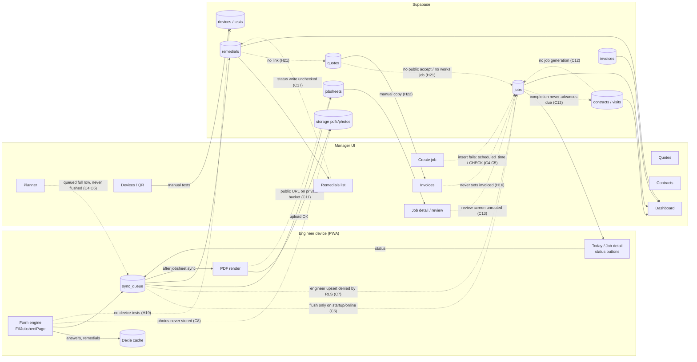

# 02 — Cross-functionality matrix

Finding IDs refer to `04-findings.md`.

## Legend

**Interaction:** R = reads · W = writes · T = triggers (an automatic ripple) · — = none

**Health:**
- ✅ working
- 🟡 partial
- ❌ broken (exists but fails)
- ⛔ missing but needed
- · not applicable

The row is the feature that acts; the column is the feature it acts on.

| Row → Col | Jobs | Planner | Jobsheet/Form | Sync | PDF | Remedials | Quotes | Contracts | Sites/Systems | Devices/QR | Invoices | Dashboard | Auth/RLS |
|---|---|---|---|---|---|---|---|---|---|---|---|---|---|
| **Jobs** | · | R ❌ C4 | R 🟡 | W ❌ C6 C7 | — | T ⛔ (done on job completion) | T ⛔ | T ⛔ C12 | R 🟡 | — | T ⛔ H16 | R 🟡 M14 | R ✅ / W 🟡 H2 |
| **Planner** | W ❌ C4 H14 | · | — | W ❌ C6 | — | — | — | R ⛔ (due visits) | R ✅ | — | — | — | R 🟡 |
| **Jobsheet/Form** | W ❌ C7 H8 | — | · | W ❌ C6 H10 | T 🟡 | W ❌ H11 C5 | — | — | R 🟡 M8 H20 | W ⛔ H19 | — | — | W 🟡 H1 |
| **Sync** | W ❌ C7 H8 | W ❌ | W 🟡 H10 M7 | · | T 🟡 H13 | W 🟡 H23 | W 🟡 | ⛔ C17 | W 🟡 H25 | W ⛔ C8 (photos) | W 🟡 | — | ❌ C15 (unscoped) |
| **PDF** | R 🟡 | — | R ❌ C8 C9 H12 | — | · | R 🟡 H11 | — | — | R 🟡 | ⛔ | — | — | storage ❌ C11 |
| **Remedials** | ⛔ (no `job_id`) | — | R ✅ | W ❌ C17 | — | · | W ⛔ H21 | — | R ✅ | R ⛔ | — | R 🟡 M14 | 🟡 H23 |
| **Quotes** | T ⛔ H21 (works job) | — | — | ⛔ C17 | ⛔ (no quote PDF) | T ⛔ H21 | · | — | R 🟡 | — | W 🟡 H22 | — | public link ⛔ H21 |
| **Contracts** | T ⛔ C12 | ⛔ | — | ⛔ C17 | — | — | — | · | R 🟡 M13 | — | — | R 🟡 M12 | R ✅ (H3 over-read) |
| **Sites/Systems** | R ✅ (CreateJob site→system) | — | R 🟡 | ⛔ C17 | R 🟡 | R ✅ | R ⛔ | R 🟡 | · | R ⛔ H24 | — | — | R ✅ |
| **Devices/QR** | — | — | ⛔ H19 | ⛔ C17 | ⛔ | T ⛔ H19 (fail → remedial) | — | — | R 🟡 M18 | · | — | ⛔ coverage | route ❌ H18 |
| **Invoices** | W ⛔ H16 | — | — | 🟡 | ⛔ | — | R 🟡 H22 | — | R ✅ | — | · | R 🟡 | R ✅ (H3) |
| **Dashboard** | R 🟡 M14 H17 | — | — | — | — | R 🟡 | — | R 🟡 M12 | R ✅ | — | R 🟡 | · | — |
| **Auth/RLS** | ❌ C1–C3 (role integrity under everything) | | | ❌ C15 | ❌ C11 M21 | | | | | | | | · |

## Health of each key link

| Link | Health | Why |
|---|---|---|
| Engineer device → server (any write) | ❌ Broken | No flush while online (C6). Engineer job upserts rejected by RLS (C7). Full-row overwrites (H8). |
| Manager writes → server | ❌ Broken | Errors ignored and never queued (C17). Job inserts rejected (C4, C5). |
| Job creation → engineer sees it | ❌ Broken | C4 (unless the column exists on the hosted DB). |
| Planner → jobs | ❌ Broken | C4, C6, H14. No clash check (H15). |
| Job status → everything downstream | ❌ Broken | Dead-ends (C10). `reviewed`, `invoiced` and `cancelled` are never set (C13, H16). |
| Jobsheet → remedials | 🟡 Partial | Detection works. Duplicates (H11). Blocked for 3 templates (C5). |
| Jobsheet → photos/signatures | ❌ / ⛔ | Photos lost (C8). Signatures base64, PDF "Not signed" (C9). |
| Jobsheet → PDF → manager | ❌ Broken | Dead URL (C11), wrong engineer (H12), no retry (H13), review screen unrouted (C13). |
| PDF → email | ⛔ Missing | H13 |
| Device test → remedial / coverage | ⛔ Missing | H19 |
| Remedial → quote → public accept → job | ⛔ Missing | H21 |
| Quote → invoice | 🟡 Partial | H22 |
| Job → invoice (`invoiced`) | ⛔ Missing | H16 |
| Contract visit → job → next due | ⛔ Missing | C12 |
| Dashboard counts | 🟡 Partial | M14, H17, M12 |
| Tenant isolation (server reads) | ✅ Working by policy | Reads are scoped by `get_my_company_id()`. **But** C1–C3 let a user join or promote themselves into any tenant, which makes isolation moot. |
| Tenant isolation (on device) | ❌ Broken | C15, H6 |
| Offline reads | ❌ Broken | Dead fallbacks (H7). Only Dexie-first detail pages work. |

## Data-flow diagram (as built)

Red dashed = broken · grey dotted = missing but needed · solid = working or partial

